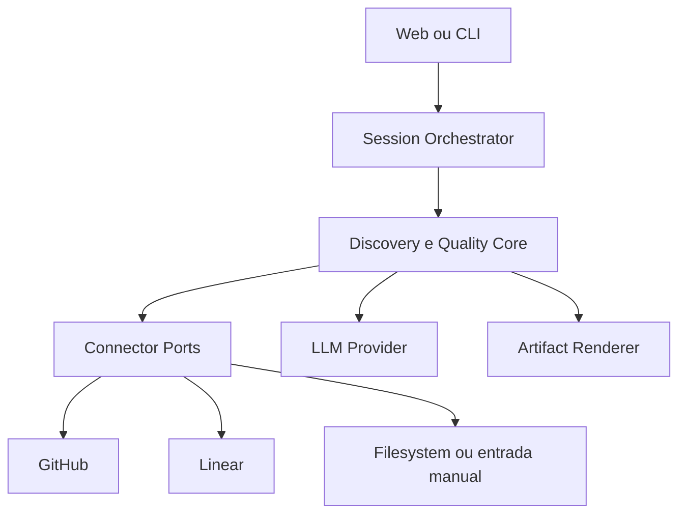

# Arquitetura inicial

## Direção

O MVP será um monólito modular TypeScript. Integrações serão adaptadores opcionais; o domínio não poderá depender diretamente de GitHub, Linear, n8n ou de um provedor específico de LLM.

## Módulos



## Portas fundamentais

```ts
interface RepositorySource {
  inspect(input: RepositoryInspectionRequest): Promise<RepositorySnapshot>;
}

interface IssueSource {
  getIssue(reference: string): Promise<IssueSnapshot>;
}

interface LanguageModel {
  generateStructured<T>(request: StructuredRequest<T>): Promise<T>;
}

interface ArtifactPublisher {
  preview(artifact: Artifact): Promise<Preview>;
  publish(artifact: Artifact, approval: Approval): Promise<PublishResult>;
}
```

## Estados da sessão

`created → discovering → awaiting_answers → ready_to_generate → draft → validating → awaiting_approval → approved → exported`

Estados alternativos: `degraded`, `blocked`, `cancelled` e `failed`.

## Limites

- `contracts`: dados compartilhados, sem infraestrutura;
- `core`: regras puras e determinísticas sempre que possível;
- `connectors`: autenticação e tradução de APIs externas;
- `api`: transporte HTTP e composição;
- `web`: apresentação e interação;
- `automations`: gatilhos externos, nunca fonte final de regras.

## Persistência prevista

Começar com SQLite no desenvolvimento e abstração compatível com PostgreSQL. Conteúdo bruto sensível deve ter retenção curta e separada de metadados e evidências derivadas.

## Decisões adiadas

- framework de persistência;
- fila de jobs;
- provedor de hospedagem;
- estratégia de embeddings;
- modelo de LLM;
- multi-tenancy.
